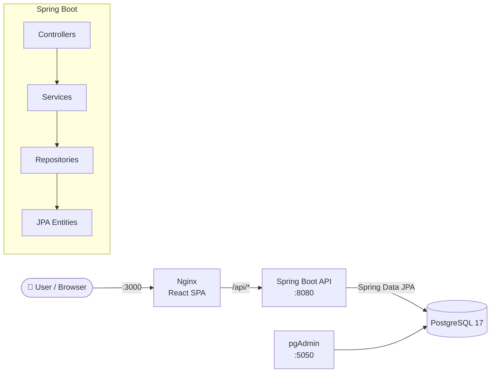
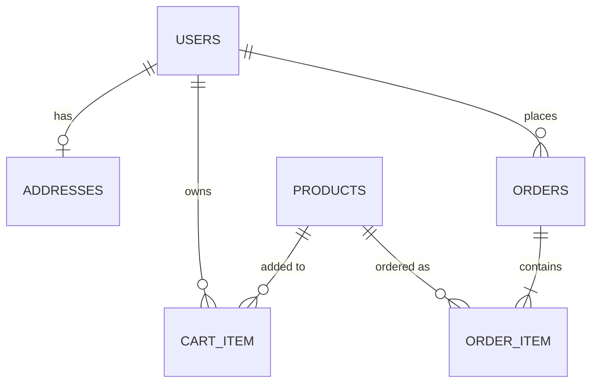

<div align="center">

# 🛒 Spring Boot + React E-Commerce Application

**Full-stack e-commerce REST API built with Java 21, Spring Boot 3, Spring Data JPA, PostgreSQL and a modern React 19 + TypeScript frontend — fully containerized with Docker Compose.**

[](https://openjdk.org/projects/jdk/21/)
[](https://spring.io/projects/spring-boot)
[](https://www.postgresql.org/)
[](https://hibernate.org/)
[](https://maven.apache.org/)

[](https://react.dev/)
[](https://www.typescriptlang.org/)
[](https://vite.dev/)
[](https://tailwindcss.com/)
[](https://docs.docker.com/compose/)
[](https://nginx.org/)

[Features](#-features) •
[Tech Stack](#-tech-stack) •
[Architecture](#-architecture) •
[Quick Start](#-quick-start) •
[API Reference](#-api-reference) •
[Roadmap](#-roadmap) •
[Türkçe](#-türkçe-özet)

</div>

---

## 📖 About

This project is a **monolithic e-commerce backend** developed while following the Udemy course
*"Monolithic to Microservices with Java Spring Cloud: Learn Kubernetes, Docker, Spring Boot, Zipkin, RabbitMQ"*.
It covers the complete shopping flow — **users, products, shopping cart and orders** — and ships with a
**React single-page application** so the API can be used from a real user interface.

The codebase is intentionally kept clean and layered (Controller → Service → Repository → Entity + DTOs),
which makes it a solid starting point for splitting into **Spring Cloud microservices** later.

## ✨ Features

### Backend (Spring Boot REST API)
- 👤 **User management** — CRUD with embedded address (one-to-one), default `CUSTOMER` role
- 📦 **Product catalog** — create / update / soft-delete (deactivate), list active products, keyword search
- 🛒 **Shopping cart** — add / remove items, quantity merge, **stock validation** including items already in the cart
- 🧾 **Order management** — checkout from cart, **transactional** order creation, automatic **stock decrease**, order history
- 🔁 **DTO pattern** — entities are never exposed directly to the client
- ⚠️ **Global exception handling** with `@RestControllerAdvice`
- 🌐 **Configurable CORS** for the frontend
- 📊 **Spring Boot Actuator** — health checks, metrics, info endpoint
- 🧪 **Integration tests** with `MockMvc` and in-memory **H2** database (no PostgreSQL needed for tests)

### Frontend (React + TypeScript)
- 🛍️ Product listing with search and one-click *Add to cart*
- 🔍 Product detail page with quantity selection
- 🛒 Cart page with order summary and checkout
- 📜 Order history and order detail with status badges
- 🛠️ Admin pages for **product** and **user** management
- ⚡ Server-state caching with **TanStack Query**, responsive UI with **Tailwind CSS**

### DevOps
- 🐳 **Docker Compose** stack: PostgreSQL + pgAdmin + Spring Boot API + React (Nginx)
- 🏗️ **Multi-stage Dockerfiles** for small production images
- ❤️ Database health check — the API only starts when PostgreSQL is ready

## 🧰 Tech Stack

| Layer | Technologies |
| --- | --- |
| **Language** | Java 21, TypeScript |
| **Backend** | Spring Boot 3.4, Spring Web (REST), Spring Data JPA, Hibernate 6, Spring Boot Actuator, Lombok |
| **Database** | PostgreSQL 17, H2 (tests), pgAdmin 4 |
| **Frontend** | React 19, Vite 8, React Router 7, TanStack Query 5, Tailwind CSS 4 |
| **Testing** | JUnit 5, Spring Boot Test, MockMvc, AssertJ |
| **Build** | Maven (wrapper included), npm |
| **DevOps** | Docker, Docker Compose, Nginx, Eclipse Temurin JRE |

## 🏛 Architecture



### Domain model



## 🚀 Quick Start

### Option 1 — Run everything with Docker (recommended)

**Requirements:** [Docker Desktop](https://www.docker.com/products/docker-desktop/)

```bash
git clone https://github.com/Albatros46/JavaSpringBootUdemy.git
cd JavaSpringBootUdemy
docker compose up -d --build
```

| Service | URL |
| --- | --- |
| 🖥️ Frontend (React) | http://localhost:3000 |
| ⚙️ REST API | http://localhost:8080 |
| ❤️ Health check | http://localhost:8080/actuator/health |
| 🐘 pgAdmin | http://localhost:5050 (`admin@admin.com` / `admin`) |

Stop the stack with `docker compose down` (data is kept in a Docker volume).

### Option 2 — Local development

**Requirements:** JDK 21+, Node.js 20+, Docker (for PostgreSQL only)

```bash
# 1. Start only the database
docker compose up -d postgres

# 2. Run the backend (http://localhost:8081)
./mvnw spring-boot:run

# 3. Run the frontend with hot reload (http://localhost:5173)
cd ecom-frontend
npm install
echo "API_PROXY_TARGET=http://localhost:8081" > .env.local
npm run dev
```

### Run the tests

```bash
./mvnw test          # backend: uses in-memory H2, no database required
cd ecom-frontend && npm run build && npm run lint   # frontend: type-check + lint
```

## 📡 API Reference

Cart and order endpoints identify the current user via the **`X-User-ID`** request header.

<details open>
<summary><b>Users</b> — <code>/api/users</code></summary>

| Method | Endpoint | Description |
| --- | --- | --- |
| `GET` | `/api/users` | List all users |
| `GET` | `/api/users/{id}` | Get user by id |
| `POST` | `/api/users` | Create user |
| `PUT` | `/api/users/{id}` | Update user |
| `DELETE` | `/api/users/{id}` | Delete user |

</details>

<details open>
<summary><b>Products</b> — <code>/api/products</code></summary>

| Method | Endpoint | Description |
| --- | --- | --- |
| `POST` | `/api/products` | Create product |
| `PUT` | `/api/products/{id}` | Update product |
| `DELETE` | `/api/products/{id}` | Deactivate product (soft delete) |
| `GET` | `/api/products/{id}` | Get product by id |
| `GET` | `/api/products/allActive` | List active products |
| `GET` | `/api/products/allProducts` | List all products |
| `GET` | `/api/products/search?keyword=` | Search active, in-stock products by name |

</details>

<details open>
<summary><b>Cart</b> — <code>/api/cart</code> (header <code>X-User-ID</code>)</summary>

| Method | Endpoint | Description |
| --- | --- | --- |
| `POST` | `/api/cart` | Add product to cart |
| `GET` | `/api/cart` | Get current user's cart |
| `DELETE` | `/api/cart/items/{productId}` | Remove product from cart |

</details>

<details open>
<summary><b>Orders</b> — <code>/api/order</code> (header <code>X-User-ID</code>)</summary>

| Method | Endpoint | Description |
| --- | --- | --- |
| `POST` | `/api/order` | Create order from cart |
| `GET` | `/api/order` | List current user's orders |
| `GET` | `/api/order/{id}` | Get order detail |

</details>

### Example: complete shopping flow

```bash
# Create a user
curl -X POST http://localhost:8080/api/users -H "Content-Type: application/json" \
  -d '{"firstName":"John","lastName":"Doe","email":"john@example.com"}'

# Create a product
curl -X POST http://localhost:8080/api/products -H "Content-Type: application/json" \
  -d '{"name":"Wireless Headphones","price":149.90,"stockQuantity":25,"category":"Electronics"}'

# Add it to the cart of user 1
curl -X POST http://localhost:8080/api/cart -H "Content-Type: application/json" -H "X-User-ID: 1" \
  -d '{"productId":1,"quantity":2}'

# Checkout
curl -X POST http://localhost:8080/api/order -H "X-User-ID: 1"
```

<details>
<summary>Example order response</summary>

```json
{
  "id": 1,
  "totalAmount": 299.80,
  "status": "CONFIRMED",
  "items": [
    { "id": 1, "productId": 1, "quantity": 2, "price": 149.90, "subTotal": 299.80 }
  ],
  "createdAt": "2026-10-14T18:05:12.345"
}
```

</details>

## 📁 Project Structure

```
.
├── src/main/java/com/ApplicationUdemy
│   ├── config/          # CORS configuration
│   ├── controller/      # REST controllers (User, Product, Cart, Order)
│   ├── dtos/            # Request / response DTOs
│   ├── enums/           # UserRole, OrderStatus
│   ├── exception/       # Global exception handler
│   ├── models/          # JPA entities
│   ├── repository/      # Spring Data JPA repositories
│   └── service/         # Business logic
├── src/test/            # Integration tests (MockMvc + H2)
├── ecom-frontend/       # React + TypeScript + Vite SPA
│   ├── src/api/         # Typed API client
│   ├── src/pages/       # Shop & admin pages
│   ├── Dockerfile       # Node build → Nginx
│   └── nginx.conf       # SPA routing + /api reverse proxy
├── Dockerfile           # Maven build → JRE runtime
└── docker-compose.yml   # PostgreSQL, pgAdmin, API, frontend
```

## 🗺 Roadmap

- [x] Layered monolith: users, products, cart, orders
- [x] Docker Compose with PostgreSQL & pgAdmin
- [x] Spring Boot Actuator monitoring
- [x] React + TypeScript frontend
- [x] Integration tests
- [ ] Spring Security + JWT authentication
- [ ] Bean Validation & standardized error responses
- [ ] Pagination & sorting
- [ ] OpenAPI / Swagger UI documentation
- [ ] Split into microservices with **Spring Cloud** (Eureka, Config Server, API Gateway)
- [ ] Async messaging with **RabbitMQ**, distributed tracing with **Zipkin**
- [ ] Kubernetes deployment & CI/CD pipeline

## 🇹🇷 Türkçe Özet

Bu proje, Udemy'deki *"Monolithic to Microservices with Java Spring Cloud"* kursu takip edilerek geliştirilmiş,
**Java 21 + Spring Boot 3 + PostgreSQL** tabanlı bir e-ticaret REST API'si ve **React 19 + TypeScript** arayüzüdür.

- **Özellikler:** kullanıcı, ürün, sepet ve sipariş yönetimi; stok kontrolü; transaction'lı sipariş oluşturma; DTO yapısı; global hata yönetimi; Actuator ile izleme.
- **Çalıştırma:** `docker compose up -d --build` → arayüz http://localhost:3000, API http://localhost:8080, pgAdmin http://localhost:5050
- **Testler:** `./mvnw test` (bellek içi H2 kullanır, PostgreSQL gerekmez)
- **Sonraki adımlar:** Spring Security + JWT, Swagger, Spring Cloud ile mikroservis mimarisine geçiş.

---

<div align="center">

**Servet Akcadag** — [@Albatros46](https://github.com/Albatros46)

If you find this project useful, please consider giving it a ⭐ — it helps others discover it!

</div>
